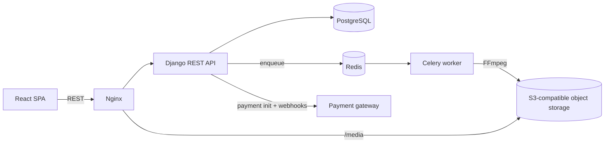

# UG Sports Story Lab: Case Study

> A mobile-responsive web platform where Ugandan sports creators publish video stories, sponsors fund them, and fans watch. This repo is a **case study only**. The source code is private, so nothing here comes from it.

## The problem

Sports content in Uganda (local football, netball, cricket, esports and more) is mostly shared as raw uploads on social platforms. Creators have no direct way to earn from it, sponsors have no trustworthy way to back specific content, and viewers on mobile data suffer from large, unadaptive video files.

The platform connects the three sides:

| Role | What they do |
|---|---|
| **Creators** | Upload stories and video, choose a revenue split, track views, likes and earnings |
| **Sponsors** | Discover creators, fund content, pay in local currency, tag sponsored moments in videos |
| **Fans** | Watch adaptive-quality video, follow creators, like and comment |
| **Admins / moderators** | Review content, resolve disputes, manage users and platform revenue |

## Architecture

- **Backend:** Django + Django REST Framework, split into apps (accounts, stories, payments, finance, analytics, notifications, video pipeline).
- **Async work:** Celery + Redis for video conversion and transactional email.
- **Storage:** S3-compatible object storage (MinIO in development, managed Spaces in production).
- **Deployment:** Docker Compose on a cloud VM, Nginx in front.

## The video pipeline (HLS)

Raw uploads are converted into **HLS adaptive-bitrate streams** so viewers on slow connections get a lower rendition instead of a stalled player.

1. Creator uploads a video; the API stores the original and enqueues a conversion task.
2. A Celery worker runs FFmpeg to produce several renditions plus a master playlist.
3. Segments and playlists are written to shared storage.
4. The player requests `master.m3u8` and switches renditions based on bandwidth. A sponsor overlay/CTA is drawn on top at tagged timestamps.

### Problems I debugged in this pipeline

| Symptom | Root cause | Fix |
|---|---|---|
| Converted videos 404 in the browser | The worker wrote HLS files to its own container filesystem, not the volume Nginx serves | Mounted the shared media volume in the worker; clear stale output before re-conversion |
| Master playlist loads, but segments 404 | FFmpeg wrote segments into per-rendition subfolders while the generated playlists referenced bare filenames | Flattened segment naming so playlist references and files agree |
| Long videos killed mid-conversion | Hard-coded 10-minute FFmpeg subprocess timeout and a slow preset | Raised the timeout and used a faster preset |
| Fixes silently disappeared after rebuilds | Edits had been made inside running containers, not in the source the image is built from | Moved all changes into the repo and committed before rebuilding |

I rebuilt a small standalone version of this pipeline, with none of the project code, here: **[hls-video-pipeline-demo](https://github.com/karubeth/hls-video-pipeline-demo)**.

## Payments and earnings

- Integrated a local payment gateway (hosted checkout, webhooks, and a manual status-sync endpoint for when webhooks are delayed).
- Built the **payment → earnings bridge**: when a sponsor's payment is confirmed, the creator is credited according to the revenue split they chose at upload (for example 70/30, 60/40 or 50/50) and the platform's share goes to an internal house account.
- Crediting is **idempotent**: whichever path marks an invoice paid (webhook, sync, admin), the creator is credited exactly once.
- Removed a "mark as paid" shortcut that let sponsors self-report payment without gateway confirmation, so paid status now comes only from the gateway.

## Other backend work

- **Analytics:** replaced placeholder metrics with real counts from the likes/comments tables, and fixed a double-counting bug where one view incremented the counter twice.
- **Disputes and notifications:** admin dispute resolution (resolve or dismiss) with in-app notifications back to the creator.
- **Background email:** moved a synchronous email call out of the request cycle into a Celery task, because it was blocking story submission.
- **Testing:** wrote integration tests for the invite-based registration flow (25 tests) and the withdrawal and payout-method endpoints (31 tests).
- **Operations:** diagnosed and fixed several migration conflicts from parallel branches, and learned to merge migrations safely on a shared environment.

## My role

I was the team lead and backend lead  on a team of five developers who worked on the sports lab. I:

- built the payment integration and the payment-to-earnings logic
- integrated and debugged the HLS pipeline end to end (the individual FFmpeg stages were built by teammates)
- wrote the analytics and dispute features, and the integration tests listed above
- owned the sponsor dashboard end to end, from backend to frontend (the platform has four role-based dashboards, and teammates owned the others)
- fixed bugs across the stack, including some on the React frontend

## Stack

Python, Django, Django REST Framework, PostgreSQL, Celery, Redis, FFmpeg, HLS, MinIO / S3, Docker Compose, Nginx, React.

## A note on code

The repository is private because it is a team project. I'm happy to walk through the design, or the demo repo above, in an interview.
